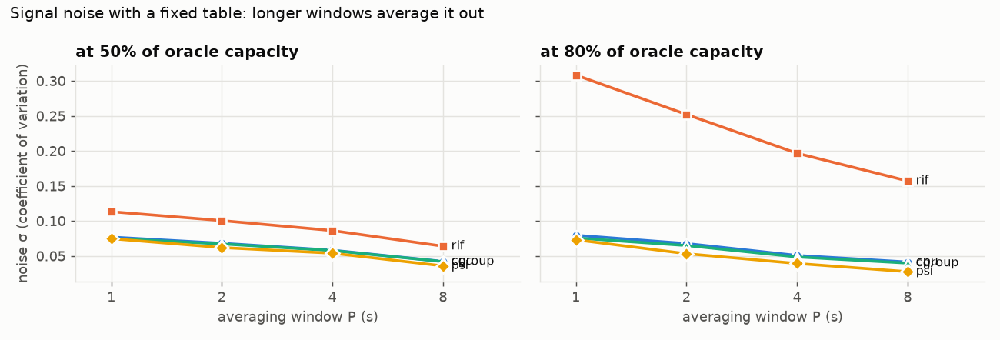
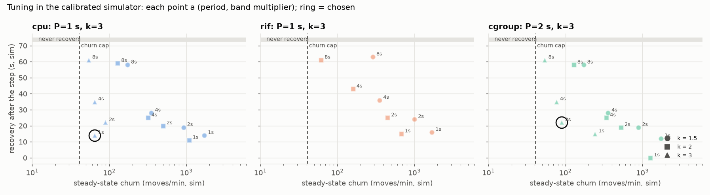
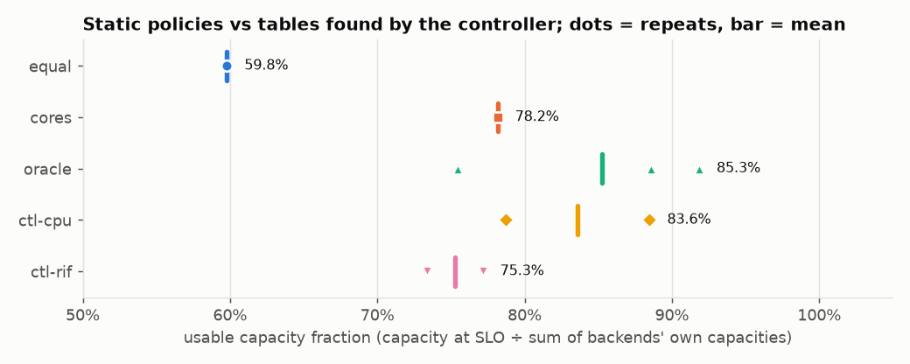
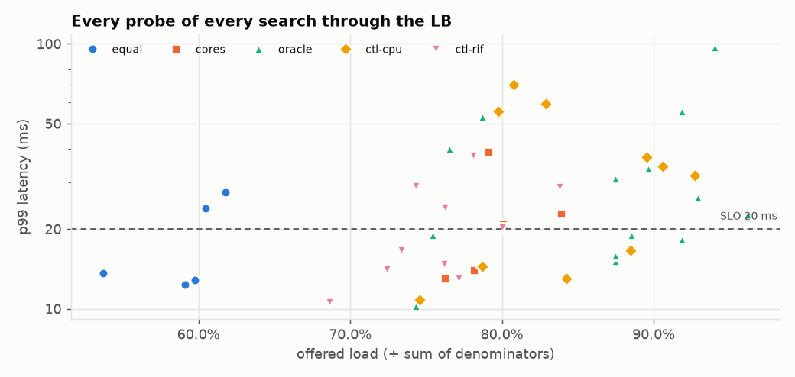
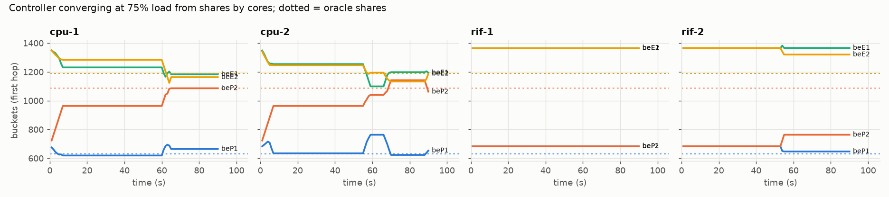

# Campaign results: campaign-20261102

## S1: denominators and signal noise

Calibration: 101432 work units = 1 ms on a P-core; an E-core takes 1.85× as long. beP1 slowness 1.6.

| backend | cores | theoretical (req/s) | capacity at SLO, per repeat | mean | % of theoretical | repeats differ by |
|---|---|---|---|---|---|---|
| beP1 | 2 | 1250 | 938, 977 | 957 | 77% | 4.1% |
| beP2 | 2 | 2000 | 1656, 1656 | 1656 | 83% | 0.0% |
| beE1 | 4 | 2166 | 1793, 1827 | 1810 | 84% | 1.9% |
| beE2 | 4 | 2166 | 1760, 1861 | 1810 | 84% | 5.6% |

Sum of denominators: **6234 req/s**. Short-protocol capacity CV (pooled over 4 pairs): **2.5%**. Smallest difference we claim between policies: **5.1%** (2× the larger of resolution 1.25% and CV).

## Tuning (D36)

Signal noise σ(P) (median over backends of the CV of P-second averages):

| signal | load | P=1 s | P=2 s | P=4 s | P=8 s |
|---|---|---|---|---|---|
| cpu | 50% | 0.077 | 0.068 | 0.058 | 0.042 |
| cpu | 80% | 0.079 | 0.068 | 0.051 | 0.041 |
| rif | 50% | 0.113 | 0.100 | 0.086 | 0.064 |
| rif | 80% | 0.308 | 0.252 | 0.197 | 0.157 |
| cgroup | 50% | 0.075 | 0.067 | 0.058 | 0.042 |
| cgroup | 80% | 0.076 | 0.065 | 0.048 | 0.040 |
| psi | 50% | 0.075 | 0.062 | 0.054 | 0.036 |
| psi | 80% | 0.073 | 0.053 | 0.039 | 0.027 |

Chosen settings (same rule for every signal):

| signal | period | k | δ_on | δ_off | churn (moves/min, sim) | recovery after a backend loses half (sim) | note |
|---|---|---|---|---|---|---|---|
| cgroup | 2 s | 3 | 0.194 | 0.097 | 89 | 22 s | no setting meets the cap of 40 moves/min; admitted up to 2 × the least churn (108) |
| cpu | 1 s | 3 | 0.238 | 0.119 | 64 | 14 s | no setting meets the cap of 40 moves/min; admitted up to 2 × the least churn (108) |
| rif | 1 s | 3 | 0.925 | 0.462 | 0 | 16 s |  |

## S2: static policies and controller-found tables (RQ1)

Usable capacity fraction = capacity at SLO through the LB ÷ sum of denominators (6234 req/s).

| policy | repeats | capacity at 20 ms (req/s) | usable fraction | range | predicted from shares | at 10 ms | at 50 ms |
|---|---|---|---|---|---|---|---|
| equal | 1 | 3726 | **59.8%** | 59.8%–59.8% | 61.4% | – | 61.8% |
| cores | 1 | 4872 | **78.2%** | 78.2%–78.2% | 87.1% | – | 83.9% |
| oracle | 3 | 5725, 5520, 4702 | **85.3%** | 75.4%–91.8% | 100.0% | – | 93.3% |
| ctl-cpu | 2 | 4907, 5515 | **83.6%** | 78.7%–88.5% | 95.5% | – | 86.2% |
| ctl-rif | 2 | 4575, 4809 | **75.3%** | 73.4%–77.1% | 87.1% | – | 80.0% |

Generator health over all S2 probes: worst dispatch lag p99 0.302 ms, worst send delay p99 23.98 ms, dropped 0.

