# Campaign results: campaign-20261102

## S1: denominators and signal noise

Calibration: 101432 work units per request = 1 ms on a P-core; an E-core takes 1.85× as long. beP1 slowness 1.6.

| backend | cores | theoretical (req/s) | capacity at SLO, per repeat | mean | % of theoretical | repeats differ by |
|---|---|---|---|---|---|---|
| beP1 | 2 | 1250 | 938, 977 | 957 | 77% | 4.1% |
| beP2 | 2 | 2000 | 1656, 1656 | 1656 | 83% | 0.0% |
| beE1 | 4 | 2166 | 1793, 1827 | 1810 | 84% | 1.9% |
| beE2 | 4 | 2166 | 1760, 1861 | 1810 | 84% | 5.6% |

Sum of denominators: **6234 req/s**. Short-protocol capacity CV (pooled over 4 pairs): **2.5%**. Smallest difference we claim between policies: **5.1%** (2× the larger of the CV and the coarsest search resolution here, 2.1%). How firm: with 4 pairs the CV's 95% interval is 1.5%–7.3%, so that limit could be anywhere from 3% to 15%.

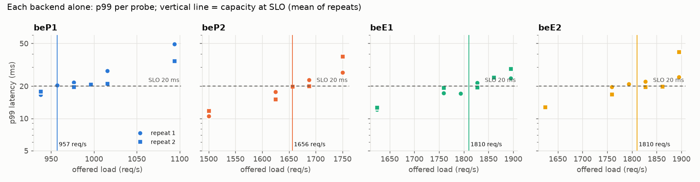

## Tuning (D36)

Signal noise σ(P) (median over backends of the CV of P-second averages):

| signal | load | P=1 s | P=2 s | P=4 s | P=8 s |
|---|---|---|---|---|---|
| cpu | 50% | 0.081 | 0.074 | 0.068 | 0.053 |
| cpu | 80% | 0.066 | 0.056 | 0.043 | 0.031 |
| rif | 50% | 0.122 | 0.111 | 0.100 | 0.079 |
| rif | 80% | 0.191 | 0.161 | 0.121 | 0.087 |
| cgroup | 50% | 0.080 | 0.074 | 0.067 | 0.052 |
| cgroup | 80% | 0.063 | 0.055 | 0.042 | 0.030 |
| psi | 50% | 0.079 | 0.068 | 0.059 | 0.046 |
| psi | 80% | 0.066 | 0.049 | 0.035 | 0.023 |

Chosen settings (same rule for every signal):

| signal | period | k | δ_on | δ_off | churn (moves/min, sim) | recovery after a backend loses half (sim) | note |
|---|---|---|---|---|---|---|---|
| cgroup | 2 s | 3 | 0.164 | 0.082 | 20 | 20 s |  |
| cpu | 2 s | 3 | 0.169 | 0.084 | 20 | 20 s |  |
| rif | 1 s | 3 | 0.574 | 0.287 | 40 | 15 s |  |
| rif-total | 2 s | 3 | 0.482 | 0.241 | 22 | 17 s |  |

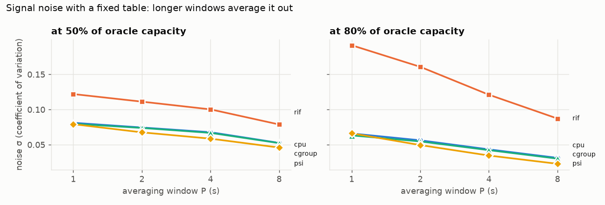

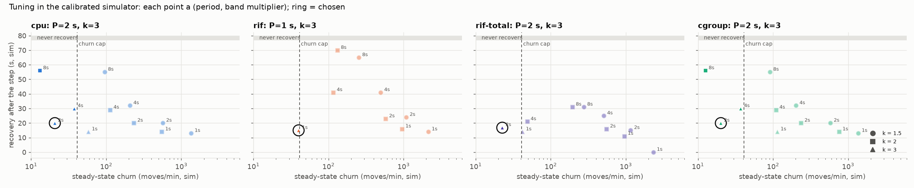

## S2: static policies and controller-found tables (RQ1)

Usable capacity fraction = capacity at SLO through the LB ÷ sum of denominators (6234 req/s).

| policy | repeats | capacity at 20 ms (req/s; ≥ = every probe passed, a lower bound) | usable fraction | range | predicted from shares | at 10 ms | at 50 ms |
|---|---|---|---|---|---|---|---|
| equal | 1 | 3894 | **62.5%** | 62.5%–62.5% | 61.4% | – | 63.1% |
| cores | 1 | 5407 | **86.7%** | 86.7%–86.7% | 87.1% | – | 87.7% |
| oracle | 3 | 5861, 5929, 5997 | **95.1%** | 94.0%–96.2% | 100.0% | – | 97.7% |
| ctl-cpu | 2 | 5986, ≥5580 | **92.8%** | 89.5%–96.0% | 90.8% | – | 100.0% |
| ctl-rif | 2 | 5290, 5504 | **86.6%** | 84.9%–88.3% | 90.5% | – | 89.0% |
| ctl-rif-total | 3 | ≥5929, 5653, 5778 | **92.8%** | 90.7%–95.1% | 87.9% | – | 95.2% |

Resolution of these searches (highest pass to next failure): typically 1.1%, at worst 26.3%.
Here p99 isn't monotonic with load near the SLO: an oracle probe passed above a rate where another failed (plotted below), so a capacity depends on which probes the bisection happened to run.

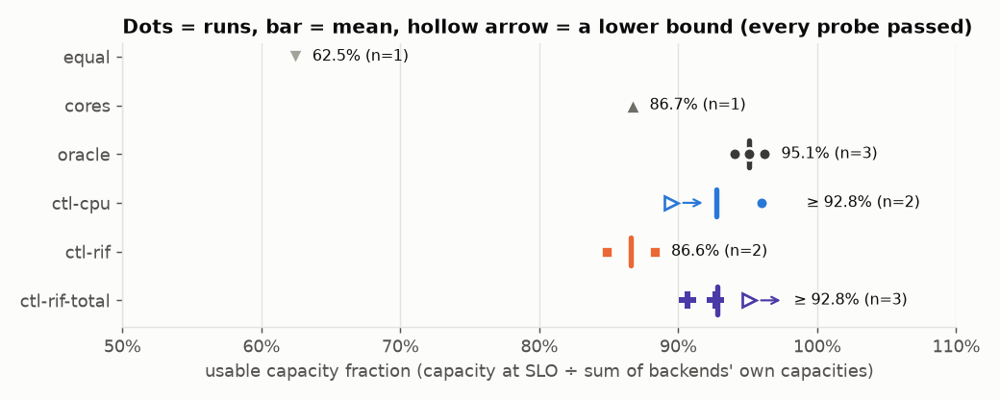

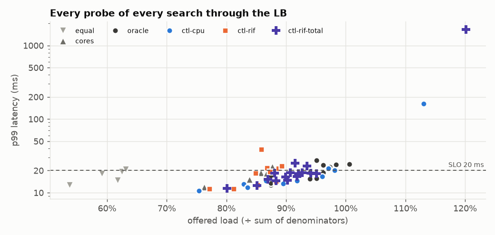

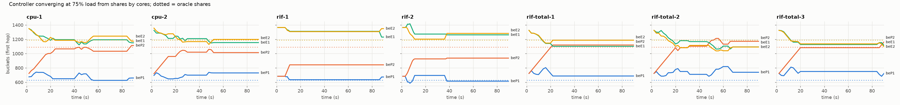

Generator health over all S2 probes: worst dispatch lag p99 0.002 ms, dropped 0.
Send delay p99 20 ms in one probe (ctl-cpu at 7048 req/s): it missed the SLO anyway (above capacity), so no result depends on it.
Send delay p99 1511 ms in one probe (ctl-rif-total at 7489 req/s): it missed the SLO anyway (above capacity), so no result depends on it.

## S6: interleaved follow-ups (one session)

Generator health over all 100 probes: worst dispatch lag p99 0.002 ms, worst send delay p99 0.14 ms, dropped 0.

### Denominators: alone vs neighbours busy (no LB)

Same protocol, one round, order alternating per backend. *Busy*: the other three backends held at 90% of their S1 capacity, generated by one load generator, this backend's requests judged.

| backend | alone, S1 (mean of 2) | alone, S6 | busy, S6 | busy ÷ alone (S6) |
|---|---|---|---|---|
| beP1 | 957 | 993 | 981 | 0.988 |
| beP2 | 1656 | 1615 | 1594 | 0.987 |
| beE1 | 1810 | 1856 | 1810 | 0.976 |
| beE2 | 1810 | 1833 | 1788 | 0.975 |
| sum | 6234 | 6296 | 6173 | 0.980 |

Coarsest search resolution here: 1.3%.

### The oracle's gap: which denominator, and with or without the LB

Oracle through the LB vs the same shares sent directly to the backends (no LB, no hashing: each request goes to a backend at random in proportion, one load generator), same range, interleaved.

| | capacities (req/s) | mean | ÷ S1 alone | ÷ S6 alone | ÷ S6 busy |
|---|---|---|---|---|---|
| oracle through the LB | 5997, 6056 | 6026 | 96.7% | 95.7% | 97.6% |
| same shares, no LB | 6175, 6292 | 6234 | 100.0% | 99.0% | 101.0% |

How evenly requests arrive: CV of each backend's requests per second, over the highest passing probe of each search: oracle through the LB 4.9%–8.6%; same shares, no LB 1.6%–4.3%.

### Capacities during the disturbances, and the hindsight tables

Each disturbed backend alone (no LB), 1 search. The hindsight table is proportional to the S1 capacities with this one replaced.

| disturbance | backend | capacity alone, S1 | during it, S6 | ratio | sum of capacities during it | 75% load is |
|---|---|---|---|---|---|---|
| step | beP2 | 1656 | 704 | 0.42 | 5281 | 89% of it |
| antagonist | beE1 | 1810 | 1188 | 0.66 | 5612 | 83% of it |

### CPU vs total RIF tables, interleaved

Run order, all in one session, same search range (0.85–1.15 × the prediction from the table's shares), each table after 90 s at 75% from shares by cores:

ctl-cpu 1 → ctl-rif-total 1 → oracle 1 → direct 1 → ctl-rif-total 2 → ctl-cpu 2 → direct 2 → oracle 2 → ctl-cpu 3 → ctl-rif-total 3

| table | run | capacity (req/s) | ÷ S1 alone | predicted from its shares | moves in the first reading |
|---|---|---|---|---|---|
| ctl-cpu | 1 | 5657 | 90.7% | 90.7% | 0 |
| ctl-cpu | 2 | 6243 | 100.1% | 93.2% | 0 |
| ctl-cpu | 3 | 5439 | 87.2% | 88.1% | 0 |
| ctl-cpu | mean | 5779 | 92.7% | | |
| ctl-rif-total | 1 | 5821 | 93.4% | 89.2% | 0 |
| ctl-rif-total | 2 | 5527 | 88.7% | 89.5% | 0 |
| ctl-rif-total | 3 | 5660 | 90.8% | 88.3% | 0 |
| ctl-rif-total | mean | 5669 | 90.9% | | |

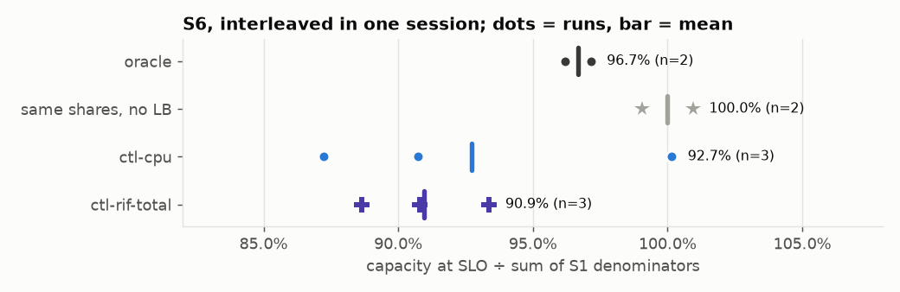

## S8: RQ1 again, 5 runs each, interleaved (one session, checkpointed)

Session started 3 time(s) (each start calibrates anew: 101252, 101310, 101252 work units per request). Generator health over all 115 probes: worst dispatch lag p99 0.002 ms, worst send delay p99 of a passing probe 0.14 ms, dropped 0.

Run order: oracle 1 → ctl-cpu 1 → ctl-rif-total 1 → ctl-cpu 2 → ctl-rif-total 2 → oracle 2 → equal 1 → cores 1 → ctl-rif-total 3 → oracle 3 → ctl-cpu 3 → oracle 4 → ctl-rif-total 4 → ctl-cpu 4 → cores 2 → equal 2 → ctl-cpu 5 → oracle 5 → ctl-rif-total 5

Each backend alone in this session (1 search each): beP1 957 (S1: 957), beP2 1615 (S1: 1656), beE1 1742 (S1: 1810), beE2 1697 (S1: 1810); sum **6011** req/s (S1: 6234).

| table | runs | capacities (req/s; ≥ = every probe passed) | mean ÷ S1 sum | 95% interval of the mean | range | std dev of a run | mean ÷ S8's own sum |
|---|---|---|---|---|---|---|---|
| equal | 2 | 4043, 4043 | **64.9%** | ± 0.0% | 64.9%–64.9% | 0.0% | 67.3% |
| cores | 2 | 5483, 5279 | **86.3%** | ± 20.8% | 84.7%–88.0% | 2.3% | 89.5% |
| oracle | 5 | 5997, 5880, 5997, 5705, 5939 | **94.7%** | ± 2.4% | 91.5%–96.2% | 1.9% | 98.2% |
| ctl-cpu | 5 | 5805, 5744, 6004, 5911, 5969 | **94.4%** | ± 2.2% | 92.1%–96.3% | 1.8% | 97.9% |
| ctl-rif-total | 5 | 5234, 5791, 5401, 5459, 5325 | **87.3%** | ± 4.2% | 84.0%–92.9% | 3.4% | 90.5% |

Resolution of these searches (highest pass to next failure): typically 0.9%, at worst 1.0%.

Differences between tables, in points of usable fraction, with 95% intervals (Welch). *Resolved* = the interval excludes 0:

| a − b | difference | 95% interval | resolved? |
|---|---|---|---|
| oracle − ctl-cpu | +0.3 | -2.5 to +3.1 | no |
| oracle − ctl-rif-total | +7.4 | +3.1 to +11.7 | **yes** |
| ctl-cpu − ctl-rif-total | +7.1 | +2.7 to +11.5 | **yes** |
| oracle − cores | +8.4 | -15.1 to +31.9 | no |
| cores − equal | +21.5 | +0.7 to +42.2 | **yes** |

Pooled with S6's runs of the same tables (same protocol and range, five days earlier, both ÷ S1's sum):

| table | runs | mean | 95% interval of the mean | range |
|---|---|---|---|---|
| oracle | 7 | 95.3% | ± 1.7% | 91.5%–97.1% |
| ctl-cpu | 8 | 93.8% | ± 3.3% | 87.2%–100.1% |
| ctl-rif-total | 8 | 88.7% | ± 2.9% | 84.0%–93.4% |

Pooled ctl-cpu − ctl-rif-total: +5.1 points, 95% interval +1.1 to +9.1: resolved.

Pooled oracle − ctl-cpu: +1.5 points, 95% interval -2.0 to +4.9: not resolved.

Pooled oracle − ctl-rif-total: +6.6 points, 95% interval +3.5 to +9.7: resolved.

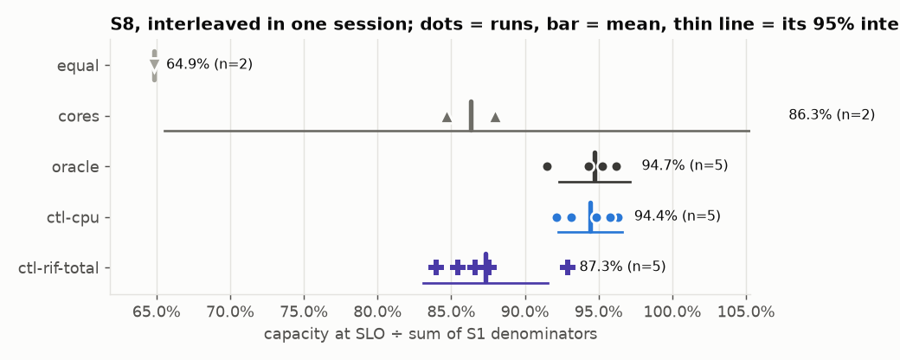

## S14: p99 at fixed loads (RQ1 without a threshold search)

Each table at fixed loads through the LB, 60 s measured per run, interleaved rounds; controller tables are found anew each round (90 s at 75% from shares by cores, then frozen). Mean with the 95% interval of the mean; range; runs within the SLO.

Run order: oracle 1 → ctl-cpu 1 → ctl-rif-total 1 → cores 1 → ctl-rif-total 2 → cores 2 → oracle 2 → ctl-cpu 2 → cores 3 → ctl-cpu 3 → ctl-rif-total 3 → oracle 3 → ctl-cpu 4 → oracle 4 → cores 4 → ctl-rif-total 4 → ctl-rif-total 5 → oracle 5 → ctl-cpu 5 → cores 5

| table | load | runs | p99 (ms): mean ± 95% | range | p50 (ms) | error rate (max) | runs within the SLO |
|---|---|---|---|---|---|---|---|
| cores | 80% | 5 | 13.6 ± 0.5 | 13.2–14.1 | 2.46 | 0.0000 | 5 of 5 |
| cores | 90% | 5 | 34.0 ± 10.9 | 26.7–48.8 | 3.82 | 0.0000 | 0 of 5 |
| oracle | 80% | 5 | 10.6 ± 0.1 | 10.5–10.6 | 2.08 | 0.0000 | 5 of 5 |
| oracle | 90% | 5 | 13.8 ± 0.9 | 13.4–15.1 | 2.62 | 0.0000 | 5 of 5 |
| ctl-cpu | 80% | 5 | 11.1 ± 0.4 | 10.8–11.5 | 2.08 | 0.0000 | 5 of 5 |
| ctl-cpu | 90% | 5 | 14.9 ± 1.0 | 13.9–16.2 | 2.65 | 0.0000 | 5 of 5 |
| ctl-rif-total | 80% | 5 | 12.7 ± 0.5 | 12.0–13.1 | 2.13 | 0.0000 | 5 of 5 |
| ctl-rif-total | 90% | 5 | 21.3 ± 7.0 | 16.2–29.4 | 2.72 | 0.0000 | 3 of 5 |

Differences in p99 (ms) with 95% intervals (Welch); *resolved* = the interval excludes 0:

| a − b | load | difference | 95% interval | resolved? |
|---|---|---|---|---|
| ctl-cpu − oracle | 80% | +0.5 | +0.1 to +0.9 | **yes** |
| ctl-cpu − oracle | 90% | +1.1 | -0.1 to +2.2 | no |
| ctl-rif-total − oracle | 80% | +2.1 | +1.6 to +2.6 | **yes** |
| ctl-rif-total − oracle | 90% | +7.5 | +0.4 to +14.5 | **yes** |
| ctl-cpu − ctl-rif-total | 80% | -1.6 | -2.1 to -1.1 | **yes** |
| ctl-cpu − ctl-rif-total | 90% | -6.4 | -13.5 to +0.7 | no |
| cores − oracle | 80% | +3.0 | +2.5 to +3.5 | **yes** |
| cores − oracle | 90% | +20.1 | +9.2 to +31.1 | **yes** |

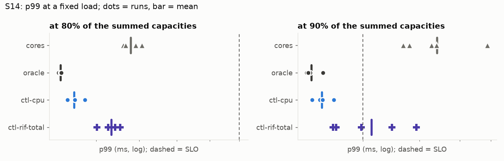

### The oracle through the LB vs the same shares without it, again

| | runs (S14) | S14: fractions of S1's sum | mean | with S6's 2 runs: mean ± 95% |
|---|---|---|---|---|
| oracle through the LB | 3 | 98.1%, 96.2%, 96.2% | 96.8% | 96.8% ± 1.0% (n=5) |
| same shares, no LB | 3 | 99.1%, 100.9%, 100.9% | 100.3% | 100.2% ± 1.3% (n=5) |

S14: no LB − through the LB = +3.5 points, 95% interval +0.7 to +6.3: resolved.

S6 + S14: no LB − through the LB = +3.4 points, 95% interval +2.0 to +4.8: resolved.

## S3 + S5 + S6 + S7 + S9 + S10 + S12: step and antagonist (RQ2, RQ3, RQ4)

Per run: p99 per 5-s window of the churn traffic (75% of the summed capacities unless the scenario's name says @60 or @85) plus long-lived connections. *Recovery*: seconds from the disturbance until p99 ≤ the SLO for 3 windows in a row. *Late p99*: median window p99 from 60 s after onset to the end of the disturbance.

### step: beP2 slowness 2 at 60 s

| config | session | rep | p99 before | recovery | late p99 | windows over SLO | churn errors | long-lived broken | backend RSTs | bucket moves (swaps) |
|---|---|---|---|---|---|---|---|---|---|---|
| oracle | S3 | 1 | 13.4 | n/a (12% errors) | 17405.5 | 83% | 100794 | 0 | 0 | 0 (0) |
| oracle | S9 | 1 | 10.6 | n/a (12% errors) | 17658.6 | 83% | 99421 | 0 | 0 | 0 (0) |
| oracle | S12 | 2 | 10.7 | n/a (14% errors) | 18138.7 | 79% | 119416 | 0 | 0 | 0 (0) |
| hindsight | S6 | 1 | 14.5 | 0 s | 15.4 | 0% | 0 | 0 | 0 | 0 (0) |
| hindsight | S9 | 1 | 13.0 | 0 s | 14.2 | 0% | 0 | 0 | 0 | 0 (0) |
| hindsight | S6 | 2 | 14.0 | 0 s | 14.5 | 4% | 0 | 0 | 0 | 0 (0) |
| hindsight | S12 | 2 | 14.8 | 0 s | 14.6 | 8% | 0 | 0 | 0 | 0 (0) |
| cpu | S3 | 1 | 11.4 | 30 s | 19.1 | 50% | 0 | 0 | 0 | 1170 (1170) |
| cpu | S9 | 1 | 10.7 | 30 s | 15.0 | 25% | 0 | 0 | 0 | 1490 (1490) |
| cpu | S3 | 2 | 11.7 | 30 s | 18.4 | 33% | 0 | 0 | 0 | 1010 (1010) |
| cpu | S9 | 2 | 10.7 | 35 s | 15.2 | 29% | 0 | 0 | 0 | 1238 (1238) |
| cpu | S3 | 3 | 11.8 | 35 s | 17.7 | 42% | 0 | 0 | 0 | 1148 (1148) |
| cpu | S9 | 3 | 10.2 | 30 s | 16.7 | 25% | 0 | 0 | 0 | 1115 (1106) |
| cpu | S12 | 4 | 10.7 | 55 s | 16.9 | 46% | 0 | 0 | 0 | 1544 (1539) |
| cpu | S12 | 5 | 11.6 | 35 s | 17.0 | 33% | 0 | 0 | 0 | 1336 (1336) |
| rif | S3 | 1 | 11.6 | 15 s | 17.2 | 25% | 0 | 0 | 0 | 4228 (4228) |
| rif | S3 | 2 | 11.8 | 15 s | 17.2 | 17% | 0 | 0 | 0 | 3926 (3910) |
| rif | S3 | 3 | 12.7 | 25 s | 18.0 | 29% | 0 | 0 | 0 | 3812 (3799) |
| rif-total | S5 | 1 | 12.9 | 45 s | 18.3 | 50% | 0 | 0 | 0 | 2861 (2861) |
| rif-total | S9 | 1 | 11.4 | 40 s | 18.1 | 50% | 0 | 0 | 0 | 1914 (1903) |
| rif-total | S5 | 2 | 12.2 | 40 s | 18.8 | 50% | 0 | 0 | 0 | 2287 (2287) |
| rif-total | S9 | 2 | 10.4 | 40 s | 17.5 | 50% | 0 | 0 | 0 | 2357 (2335) |
| rif-total | S9 | 3 | 11.7 | 40 s | 16.8 | 42% | 0 | 0 | 0 | 1807 (1807) |
| rif-total | S12 | 4 | 11.3 | 30 s | 17.5 | 29% | 0 | 0 | 0 | 1584 (1550) |
| rif-total | S12 | 5 | 11.0 | 40 s | 19.6 | 58% | 0 | 0 | 0 | 2317 (2240) |

Per config, over its runs (range; median in brackets):

| config | runs | recovery (s) | windows over SLO | late p99 (ms) | long-lived broken | backend RSTs |
|---|---|---|---|---|---|---|
| oracle | 3 | n/a (12% errors), n/a (14% errors) | 79%–83% (83%) | 17405.5–18138.7 (17658.6) | 0 | 0 |
| hindsight | 4 | 0–0 (0) | 0%–8% (2%) | 14.2–15.4 (14.6) | 0 | 0 |
| cpu | 8 | 30–55 (32.5) | 25%–50% (33%) | 15.0–19.1 (16.9) | 0 | 0 |
| rif | 3 | 15–25 (15) | 17%–29% (25%) | 17.2–18.0 (17.2) | 0 | 0 |
| rif-total | 7 | 30–45 (40) | 29%–58% (50%) | 16.8–19.6 (18.1) | 0 | 0 |

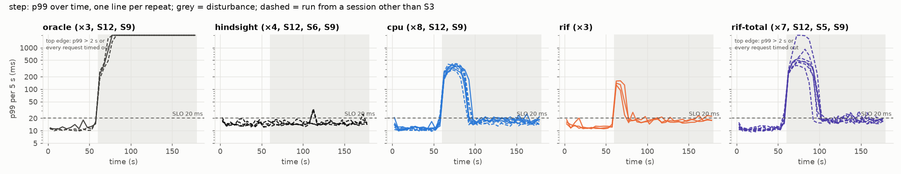

### antagonist: antagonist on beE1 at 60 s, antagonist off at 180 s

| config | session | rep | p99 before | recovery | late p99 | windows over SLO | churn errors | long-lived broken | backend RSTs | bucket moves (swaps) |
|---|---|---|---|---|---|---|---|---|---|---|
| oracle | S3 | 1 | 11.4 | never | 205.9 | 100% | 0 | 0 | 0 | 0 (0) |
| oracle | S9 | 1 | 10.4 | never | 3416.8 | 100% | 0 | 0 | 0 | 0 (0) |
| oracle | S12 | 2 | 10.8 | never | 6148.4 | 100% | 0 | 0 | 0 | 0 (0) |
| hindsight | S6 | 1 | 11.6 | 0 s | 13.0 | 0% | 0 | 0 | 0 | 0 (0) |
| hindsight | S9 | 1 | 12.1 | 10 s | 12.6 | 4% | 0 | 0 | 0 | 0 (0) |
| hindsight | S6 | 2 | 11.8 | 0 s | 13.3 | 4% | 0 | 0 | 0 | 0 (0) |
| hindsight | S12 | 2 | 11.5 | 0 s | 13.6 | 0% | 0 | 0 | 0 | 0 (0) |
| cpu | S3 | 1 | 11.7 | 10 s | 16.1 | 17% | 0 | 0 | 0 | 1425 (1425) |
| cpu | S7 | 1 | 10.5 | 10 s | 16.8 | 12% | 0 | 0 | 0 | 1582 (1582) |
| cpu | S9 | 1 | 10.4 | 20 s | 13.6 | 17% | 0 | 0 | 0 | 1359 (1359) |
| cpu | S3 | 2 | 11.9 | 10 s | 15.0 | 17% | 0 | 0 | 0 | 1544 (1544) |
| cpu | S7 | 2 | 10.7 | 10 s | 13.8 | 12% | 0 | 0 | 0 | 1472 (1472) |
| cpu | S9 | 2 | 10.7 | 15 s | 16.5 | 25% | 0 | 0 | 0 | 1506 (1498) |
| cpu | S3 | 3 | 13.5 | 10 s | 15.1 | 21% | 0 | 0 | 0 | 2158 (2158) |
| cpu | S12 | 3 | 11.1 | 20 s | 14.6 | 17% | 0 | 0 | 0 | 865 (865) |
| cpu | S12 | 4 | 10.8 | 15 s | 13.8 | 12% | 0 | 0 | 0 | 1563 (1563) |
| cpu | S12 | 5 | 10.9 | 15 s | 14.4 | 12% | 0 | 0 | 0 | 1462 (1462) |
| rif | S3 | 1 | 11.3 | 10 s | 15.0 | 25% | 0 | 0 | 0 | 3216 (3216) |
| rif | S3 | 2 | 11.4 | 5 s | 17.7 | 21% | 0 | 0 | 0 | 3751 (3751) |
| rif | S3 | 3 | 12.2 | 10 s | 16.5 | 8% | 0 | 0 | 0 | 2675 (2675) |
| rif-total | S5 | 1 | 11.1 | 10 s | 13.5 | 12% | 0 | 0 | 0 | 1364 (1364) |
| rif-total | S7 | 1 | 11.1 | 10 s | 13.3 | 8% | 0 | 0 | 0 | 1018 (1018) |
| rif-total | S9 | 1 | 11.0 | 15 s | 14.3 | 12% | 0 | 0 | 0 | 2337 (2337) |
| rif-total | S5 | 2 | 11.4 | 10 s | 15.6 | 8% | 0 | 0 | 0 | 1241 (1241) |
| rif-total | S7 | 2 | 11.5 | 5 s | 13.8 | 8% | 0 | 0 | 0 | 2161 (2161) |
| rif-total | S9 | 2 | 10.7 | 15 s | 15.1 | 12% | 0 | 0 | 0 | 2677 (2670) |
| rif-total | S12 | 3 | 11.7 | 15 s | 14.1 | 12% | 0 | 0 | 0 | 2480 (2480) |
| rif-total | S12 | 4 | 11.3 | 30 s | 13.8 | 25% | 0 | 0 | 0 | 2309 (2309) |
| rif-total | S12 | 5 | 11.0 | 10 s | 15.7 | 8% | 0 | 0 | 0 | 1975 (1975) |
| cgroup | S3 | 1 | 11.6 | never | 85.4 | 100% | 0 | 0 | 0 | 787 (787) |
| cgroup | S10 | 1 | 10.6 | never | 5201.6 | 100% | 0 | 0 | 0 | 2154 (2154) |
| cgroup | S10 | 2 | 10.6 | never | 6330.0 | 100% | 0 | 0 | 0 | 1994 (1994) |
| cpu-noprotect | S3 | 1 | 12.3 | 10 s | 18.4 | 38% | 0 | 0 | 0 | 16311 (16311) |
| cpu-noredirect | S5 | 1 | 10.7 | 10 s | 12.9 | 8% | 160 | 36 | 395 | 1359 (1359) |
| cpu-noredirect | S10 | 1 | 10.5 | 15 s | 14.7 | 12% | 227 | 45 | 581 | 1487 (1487) |
| cpu-noredirect | S10 | 2 | 11.0 | 10 s | 14.2 | 12% | 188 | 38 | 485 | 1600 (1600) |

Per config, over its runs (range; median in brackets):

| config | runs | recovery (s) | windows over SLO | late p99 (ms) | long-lived broken | backend RSTs |
|---|---|---|---|---|---|---|
| oracle | 3 | never | 100%–100% (100%) | 205.9–6148.4 (3416.8) | 0 | 0 |
| hindsight | 4 | 0–10 (0) | 0%–4% (2%) | 12.6–13.6 (13.1) | 0 | 0 |
| cpu | 10 | 10–20 (12.5) | 12%–25% (17%) | 13.6–16.8 (14.8) | 0 | 0 |
| rif | 3 | 5–10 (10) | 8%–25% (21%) | 15.0–17.7 (16.5) | 0 | 0 |
| rif-total | 9 | 5–30 (10) | 8%–25% (12%) | 13.3–15.7 (14.1) | 0 | 0 |
| cgroup | 3 | never | 100%–100% (100%) | 85.4–6330.0 (5201.6) | 0 | 0 |
| cpu-noprotect | 1 | 10–10 (10) | 38%–38% (38%) | 18.4–18.4 (18.4) | 0 | 0 |
| cpu-noredirect | 3 | 10–15 (10) | 8%–12% (12%) | 12.9–14.7 (14.2) | 119 | 1461 |

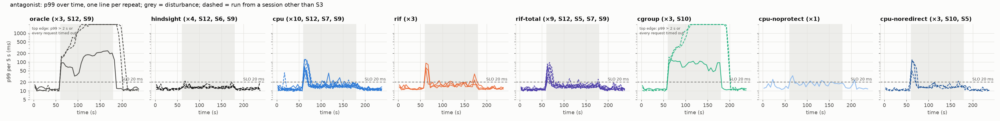

## S9 + S12 alone: step and antagonist, statics and controllers from the same sessions

Per run: p99 per 5-s window of the churn traffic (75% of the summed capacities unless the scenario's name says @60 or @85) plus long-lived connections. *Recovery*: seconds from the disturbance until p99 ≤ the SLO for 3 windows in a row. *Late p99*: median window p99 from 60 s after onset to the end of the disturbance.

### step: beP2 slowness 2 at 60 s

| config | session | rep | p99 before | recovery | late p99 | windows over SLO | churn errors | long-lived broken | backend RSTs | bucket moves (swaps) |
|---|---|---|---|---|---|---|---|---|---|---|
| oracle | S9 | 1 | 10.6 | n/a (12% errors) | 17658.6 | 83% | 99421 | 0 | 0 | 0 (0) |
| oracle | S12 | 2 | 10.7 | n/a (14% errors) | 18138.7 | 79% | 119416 | 0 | 0 | 0 (0) |
| hindsight | S9 | 1 | 13.0 | 0 s | 14.2 | 0% | 0 | 0 | 0 | 0 (0) |
| hindsight | S12 | 2 | 14.8 | 0 s | 14.6 | 8% | 0 | 0 | 0 | 0 (0) |
| cpu | S9 | 1 | 10.7 | 30 s | 15.0 | 25% | 0 | 0 | 0 | 1490 (1490) |
| cpu | S9 | 2 | 10.7 | 35 s | 15.2 | 29% | 0 | 0 | 0 | 1238 (1238) |
| cpu | S9 | 3 | 10.2 | 30 s | 16.7 | 25% | 0 | 0 | 0 | 1115 (1106) |
| cpu | S12 | 4 | 10.7 | 55 s | 16.9 | 46% | 0 | 0 | 0 | 1544 (1539) |
| cpu | S12 | 5 | 11.6 | 35 s | 17.0 | 33% | 0 | 0 | 0 | 1336 (1336) |
| rif-total | S9 | 1 | 11.4 | 40 s | 18.1 | 50% | 0 | 0 | 0 | 1914 (1903) |
| rif-total | S9 | 2 | 10.4 | 40 s | 17.5 | 50% | 0 | 0 | 0 | 2357 (2335) |
| rif-total | S9 | 3 | 11.7 | 40 s | 16.8 | 42% | 0 | 0 | 0 | 1807 (1807) |
| rif-total | S12 | 4 | 11.3 | 30 s | 17.5 | 29% | 0 | 0 | 0 | 1584 (1550) |
| rif-total | S12 | 5 | 11.0 | 40 s | 19.6 | 58% | 0 | 0 | 0 | 2317 (2240) |

Per config, over its runs (range; median in brackets):

| config | runs | recovery (s) | windows over SLO | late p99 (ms) | long-lived broken | backend RSTs |
|---|---|---|---|---|---|---|
| oracle | 2 | n/a (12% errors), n/a (14% errors) | 79%–83% (81%) | 17658.6–18138.7 (17898.6) | 0 | 0 |
| hindsight | 2 | 0–0 (0) | 0%–8% (4%) | 14.2–14.6 (14.4) | 0 | 0 |
| cpu | 5 | 30–55 (35) | 25%–46% (29%) | 15.0–17.0 (16.7) | 0 | 0 |
| rif-total | 5 | 30–40 (40) | 29%–58% (50%) | 16.8–19.6 (17.5) | 0 | 0 |

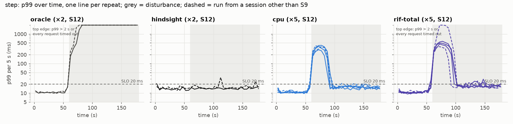

### antagonist: antagonist on beE1 at 60 s, antagonist off at 180 s

| config | session | rep | p99 before | recovery | late p99 | windows over SLO | churn errors | long-lived broken | backend RSTs | bucket moves (swaps) |
|---|---|---|---|---|---|---|---|---|---|---|
| oracle | S9 | 1 | 10.4 | never | 3416.8 | 100% | 0 | 0 | 0 | 0 (0) |
| oracle | S12 | 2 | 10.8 | never | 6148.4 | 100% | 0 | 0 | 0 | 0 (0) |
| hindsight | S9 | 1 | 12.1 | 10 s | 12.6 | 4% | 0 | 0 | 0 | 0 (0) |
| hindsight | S12 | 2 | 11.5 | 0 s | 13.6 | 0% | 0 | 0 | 0 | 0 (0) |
| cpu | S9 | 1 | 10.4 | 20 s | 13.6 | 17% | 0 | 0 | 0 | 1359 (1359) |
| cpu | S9 | 2 | 10.7 | 15 s | 16.5 | 25% | 0 | 0 | 0 | 1506 (1498) |
| cpu | S12 | 3 | 11.1 | 20 s | 14.6 | 17% | 0 | 0 | 0 | 865 (865) |
| cpu | S12 | 4 | 10.8 | 15 s | 13.8 | 12% | 0 | 0 | 0 | 1563 (1563) |
| cpu | S12 | 5 | 10.9 | 15 s | 14.4 | 12% | 0 | 0 | 0 | 1462 (1462) |
| rif-total | S9 | 1 | 11.0 | 15 s | 14.3 | 12% | 0 | 0 | 0 | 2337 (2337) |
| rif-total | S9 | 2 | 10.7 | 15 s | 15.1 | 12% | 0 | 0 | 0 | 2677 (2670) |
| rif-total | S12 | 3 | 11.7 | 15 s | 14.1 | 12% | 0 | 0 | 0 | 2480 (2480) |
| rif-total | S12 | 4 | 11.3 | 30 s | 13.8 | 25% | 0 | 0 | 0 | 2309 (2309) |
| rif-total | S12 | 5 | 11.0 | 10 s | 15.7 | 8% | 0 | 0 | 0 | 1975 (1975) |

Per config, over its runs (range; median in brackets):

| config | runs | recovery (s) | windows over SLO | late p99 (ms) | long-lived broken | backend RSTs |
|---|---|---|---|---|---|---|
| oracle | 2 | never | 100%–100% (100%) | 3416.8–6148.4 (4782.6) | 0 | 0 |
| hindsight | 2 | 0–10 (5) | 0%–4% (2%) | 12.6–13.6 (13.1) | 0 | 0 |
| cpu | 5 | 15–20 (15) | 12%–25% (17%) | 13.6–16.5 (14.4) | 0 | 0 |
| rif-total | 5 | 10–30 (15) | 8%–25% (12%) | 13.8–15.7 (14.3) | 0 | 0 |

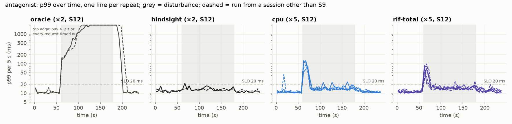

## S13: the same disturbances at 60% and 85% load

Per run: p99 per 5-s window of the churn traffic (75% of the summed capacities unless the scenario's name says @60 or @85) plus long-lived connections. *Recovery*: seconds from the disturbance until p99 ≤ the SLO for 3 windows in a row. *Late p99*: median window p99 from 60 s after onset to the end of the disturbance.

### antagonist@60: antagonist on beE1 at 60 s, antagonist off at 180 s

| config | session | rep | p99 before | recovery | late p99 | windows over SLO | churn errors | long-lived broken | backend RSTs | bucket moves (swaps) |
|---|---|---|---|---|---|---|---|---|---|---|
| oracle | S13 | 1 | 8.9 | 0 s | 13.8 | 21% | 0 | 0 | 0 | 0 (0) |
| hindsight | S13 | 1 | 9.3 | 0 s | 10.4 | 0% | 0 | 0 | 0 | 0 (0) |
| cpu | S13 | 1 | 9.2 | 5 s | 10.8 | 4% | 0 | 0 | 0 | 1857 (1857) |
| rif-total | S13 | 1 | 8.9 | 0 s | 11.2 | 0% | 0 | 0 | 0 | 905 (905) |

Per config, over its runs (range; median in brackets):

| config | runs | recovery (s) | windows over SLO | late p99 (ms) | long-lived broken | backend RSTs |
|---|---|---|---|---|---|---|
| oracle | 1 | 0–0 (0) | 21%–21% (21%) | 13.8–13.8 (13.8) | 0 | 0 |
| hindsight | 1 | 0–0 (0) | 0%–0% (0%) | 10.4–10.4 (10.4) | 0 | 0 |
| cpu | 1 | 5–5 (5) | 4%–4% (4%) | 10.8–10.8 (10.8) | 0 | 0 |
| rif-total | 1 | 0–0 (0) | 0%–0% (0%) | 11.2–11.2 (11.2) | 0 | 0 |

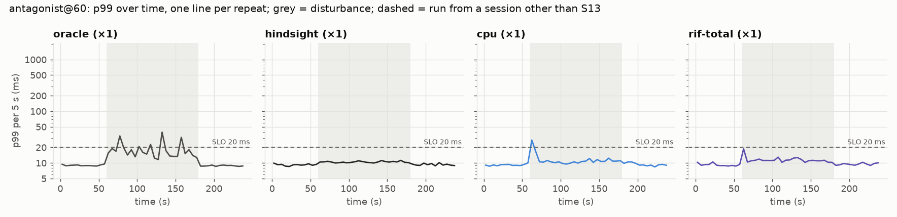

### antagonist@85: antagonist on beE1 at 60 s, antagonist off at 180 s

| config | session | rep | p99 before | recovery | late p99 | windows over SLO | churn errors | long-lived broken | backend RSTs | bucket moves (swaps) |
|---|---|---|---|---|---|---|---|---|---|---|
| oracle | S13 | 1 | 12.5 | never | 14720.9 | 100% | 0 | 0 | 0 | 0 (0) |
| hindsight | S13 | 1 | 14.8 | 5 s | 22.4 | 58% | 0 | 0 | 0 | 0 (0) |
| cpu | S13 | 1 | 12.8 | never | 29.4 | 100% | 0 | 0 | 0 | 1775 (1775) |
| rif-total | S13 | 1 | 12.7 | never | 22.6 | 88% | 0 | 0 | 0 | 3956 (3942) |

Per config, over its runs (range; median in brackets):

| config | runs | recovery (s) | windows over SLO | late p99 (ms) | long-lived broken | backend RSTs |
|---|---|---|---|---|---|---|
| oracle | 1 | never | 100%–100% (100%) | 14720.9–14720.9 (14720.9) | 0 | 0 |
| hindsight | 1 | 5–5 (5) | 58%–58% (58%) | 22.4–22.4 (22.4) | 0 | 0 |
| cpu | 1 | never | 100%–100% (100%) | 29.4–29.4 (29.4) | 0 | 0 |
| rif-total | 1 | never | 88%–88% (88%) | 22.6–22.6 (22.6) | 0 | 0 |

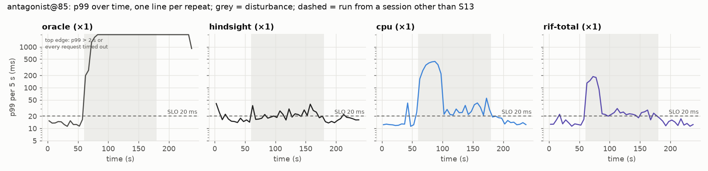

### step@60: beP2 slowness 2 at 60 s

| config | session | rep | p99 before | recovery | late p99 | windows over SLO | churn errors | long-lived broken | backend RSTs | bucket moves (swaps) |
|---|---|---|---|---|---|---|---|---|---|---|
| oracle | S13 | 1 | 8.8 | never | 565.2 | 100% | 0 | 0 | 0 | 0 (0) |
| hindsight | S13 | 1 | 9.9 | 0 s | 10.8 | 0% | 0 | 0 | 0 | 0 (0) |
| cpu | S13 | 1 | 8.9 | 15 s | 11.0 | 12% | 0 | 0 | 0 | 1886 (1886) |
| rif-total | S13 | 1 | 9.3 | 20 s | 12.8 | 17% | 0 | 0 | 0 | 1425 (1295) |

Per config, over its runs (range; median in brackets):

| config | runs | recovery (s) | windows over SLO | late p99 (ms) | long-lived broken | backend RSTs |
|---|---|---|---|---|---|---|
| oracle | 1 | never | 100%–100% (100%) | 565.2–565.2 (565.2) | 0 | 0 |
| hindsight | 1 | 0–0 (0) | 0%–0% (0%) | 10.8–10.8 (10.8) | 0 | 0 |
| cpu | 1 | 15–15 (15) | 12%–12% (12%) | 11.0–11.0 (11.0) | 0 | 0 |
| rif-total | 1 | 20–20 (20) | 17%–17% (17%) | 12.8–12.8 (12.8) | 0 | 0 |

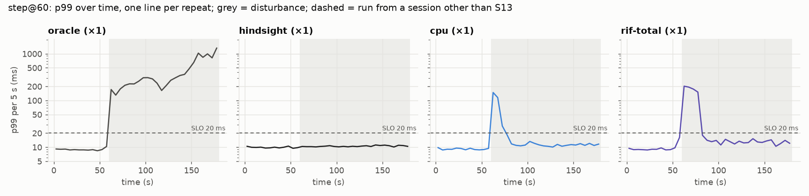

## S15: controller gain 0.1, 0.3 (ours), 1, and no protection (antagonist)

Per run: p99 per 5-s window of the churn traffic (75% of the summed capacities unless the scenario's name says @60 or @85) plus long-lived connections. *Recovery*: seconds from the disturbance until p99 ≤ the SLO for 3 windows in a row. *Late p99*: median window p99 from 60 s after onset to the end of the disturbance.

### antagonist: antagonist on beE1 at 60 s, antagonist off at 180 s

| config | session | rep | p99 before | recovery | late p99 | windows over SLO | churn errors | long-lived broken | backend RSTs | bucket moves (swaps) |
|---|---|---|---|---|---|---|---|---|---|---|
| cpu | S15 | 1 | 10.6 | 15 s | 13.9 | 17% | 0 | 0 | 0 | 1437 (1437) |
| cpu | S15 | 2 | 10.4 | 15 s | 13.6 | 12% | 0 | 0 | 0 | 1231 (1231) |
| cpu-gain0.1 | S15 | 1 | 10.4 | 20 s | 13.0 | 17% | 0 | 0 | 0 | 933 (933) |
| cpu-gain0.1 | S15 | 2 | 10.6 | 20 s | 13.5 | 17% | 0 | 0 | 0 | 752 (752) |
| cpu-gain1 | S15 | 1 | 10.6 | 10 s | 15.6 | 8% | 0 | 0 | 0 | 1995 (1995) |
| cpu-gain1 | S15 | 2 | 9.9 | 20 s | 13.7 | 17% | 0 | 0 | 0 | 1521 (1521) |
| cpu-noprotect | S15 | 1 | 10.5 | 10 s | 14.6 | 21% | 0 | 10 | 13 | 16843 (16200) |
| cpu-noprotect | S15 | 2 | 12.1 | 25 s | 18.2 | 29% | 0 | 1 | 1 | 17665 (17650) |

Per config, over its runs (range; median in brackets):

| config | runs | recovery (s) | windows over SLO | late p99 (ms) | long-lived broken | backend RSTs |
|---|---|---|---|---|---|---|
| cpu | 2 | 15–15 (15) | 12%–17% (15%) | 13.6–13.9 (13.8) | 0 | 0 |
| cpu-gain0.1 | 2 | 20–20 (20) | 17%–17% (17%) | 13.0–13.5 (13.3) | 0 | 0 |
| cpu-gain1 | 2 | 10–20 (15) | 8%–17% (12%) | 13.7–15.6 (14.6) | 0 | 0 |
| cpu-noprotect | 2 | 10–25 (17.5) | 21%–29% (25%) | 14.6–18.2 (16.4) | 11 | 14 |

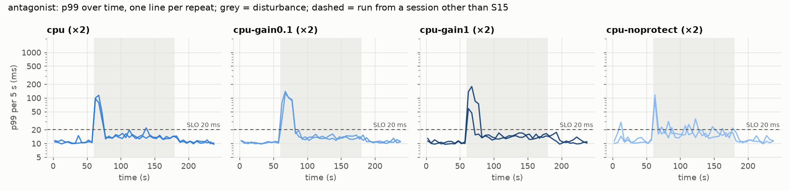

### Which signals see a neighbour in another cgroup (H5)

beE1's signals in the static-oracle run, relative to their own mean in the 30 s before the disturbance:

| signal | before | during (mean) | ratio |
|---|---|---|---|
| cpu | 0.757 | 0.998 | **1.32×** |
| rif | 1.190 | 39.212 | **32.95×** |
| cgroup | 0.760 | 0.691 | **0.91×** |
| psi | 0.107 | 0.346 | **3.24×** |

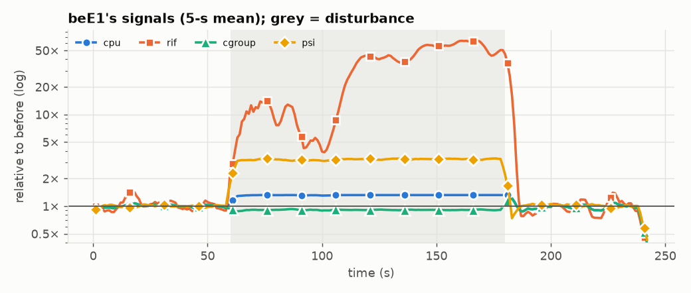

## S4 + S5 + S10: flapping antagonist, sibling antagonist

Per run: p99 per 5-s window of the churn traffic (75% of the summed capacities unless the scenario's name says @60 or @85) plus long-lived connections. *Recovery*: seconds from the disturbance until p99 ≤ the SLO for 3 windows in a row. *Late p99*: median window p99 from 60 s after onset to the end of the disturbance.

### flapping: antagonist on at 60 s, antagonist off at 70 s, antagonist on at 80 s …

| config | session | rep | p99 before | recovery | late p99 | windows over SLO | churn errors | long-lived broken | backend RSTs | bucket moves (swaps) |
|---|---|---|---|---|---|---|---|---|---|---|
| oracle | S4 | 1 | 10.7 | never | 29.4 | 50% | 0 | 0 | 0 | 0 (0) |
| cpu | S4 | 1 | 11.9 | 10 s | 15.5 | 12% | 0 | 0 | 0 | 2812 (2812) |
| rif | S4 | 1 | 11.9 | 70 s | 14.6 | 38% | 0 | 0 | 0 | 5199 (5199) |

Per config, over its runs (range; median in brackets):

| config | runs | recovery (s) | windows over SLO | late p99 (ms) | long-lived broken | backend RSTs |
|---|---|---|---|---|---|---|
| oracle | 1 | never | 50%–50% (50%) | 29.4–29.4 (29.4) | 0 | 0 |
| cpu | 1 | 10–10 (10) | 12%–12% (12%) | 15.5–15.5 (15.5) | 0 | 0 |
| rif | 1 | 70–70 (70) | 38%–38% (38%) | 14.6–14.6 (14.6) | 0 | 0 |

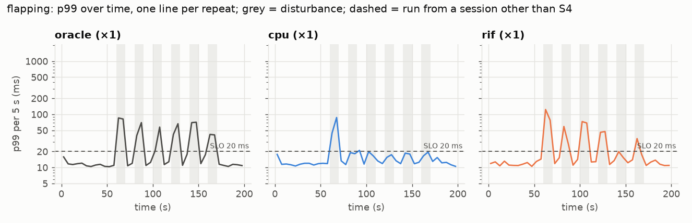

### sibling: antagonist on CPUs 9,11 at 60 s, antagonist off at 150 s

| config | session | rep | p99 before | recovery | late p99 | windows over SLO | churn errors | long-lived broken | backend RSTs | bucket moves (swaps) |
|---|---|---|---|---|---|---|---|---|---|---|
| oracle | S4 | 1 | 11.5 | 0 s | 11.3 | 0% | 0 | 0 | 0 | 0 (0) |

Per config, over its runs (range; median in brackets):

| config | runs | recovery (s) | windows over SLO | late p99 (ms) | long-lived broken | backend RSTs |
|---|---|---|---|---|---|---|
| oracle | 1 | 0–0 (0) | 0%–0% (0%) | 11.3–11.3 (11.3) | 0 | 0 |

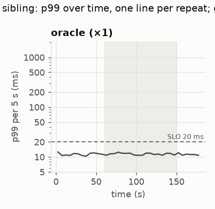

### sibling-stream: burn antagonist on CPUs 9,11 at 30 s, antagonist off at 90 s, stream antagonist on CPUs 9,11 at 100 s …

| config | session | rep | p99 before | recovery | late p99 | windows over SLO | churn errors | long-lived broken | backend RSTs | bucket moves (swaps) |
|---|---|---|---|---|---|---|---|---|---|---|
| oracle | S5 | 1 | 10.7 | 0 s | 10.9 | 0% | 0 | 0 | 0 | 0 (0) |

Per config, over its runs (range; median in brackets):

| config | runs | recovery (s) | windows over SLO | late p99 (ms) | long-lived broken | backend RSTs |
|---|---|---|---|---|---|---|
| oracle | 1 | 0–0 (0) | 0%–0% (0%) | 10.9–10.9 (10.9) | 0 | 0 |

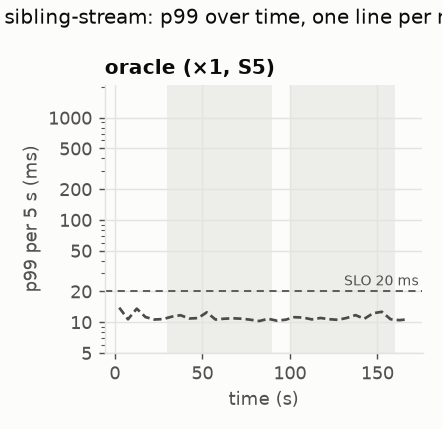

### flapping-5: antagonist on at 30.0 s, antagonist off at 32.5 s, antagonist on at 35.0 s …

| config | session | rep | p99 before | recovery | late p99 | windows over SLO | churn errors | long-lived broken | backend RSTs | bucket moves (swaps) |
|---|---|---|---|---|---|---|---|---|---|---|
| oracle | S5 | 1 | 11.2 | never | 30.4 | 96% | 0 | 0 | 0 | 0 (0) |
| cpu | S5 | 1 | 12.2 | 10.0 s | 12.8 | 12% | 0 | 0 | 0 | 1874 (1874) |
| rif-total | S5 | 1 | 11.9 | 20.0 s | 12.5 | 12% | 0 | 0 | 0 | 1495 (1495) |

Per config, over its runs (range; median in brackets):

| config | runs | recovery (s) | windows over SLO | late p99 (ms) | long-lived broken | backend RSTs |
|---|---|---|---|---|---|---|
| oracle | 1 | never | 96%–96% (96%) | 30.4–30.4 (30.4) | 0 | 0 |
| cpu | 1 | 10–10 (10) | 12%–12% (12%) | 12.8–12.8 (12.8) | 0 | 0 |
| rif-total | 1 | 20–20 (20) | 12%–12% (12%) | 12.5–12.5 (12.5) | 0 | 0 |

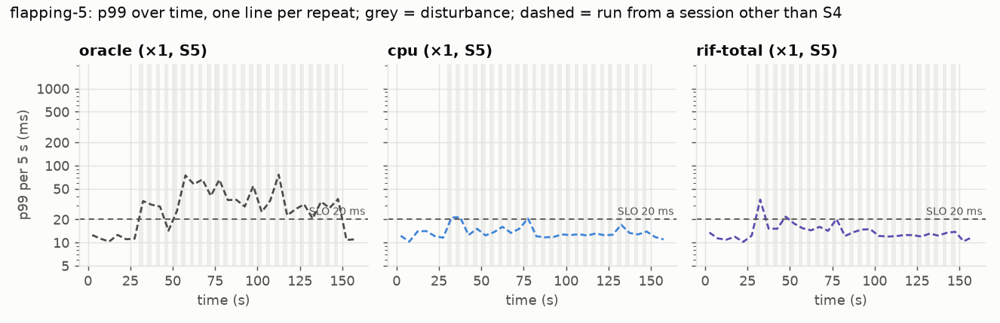

### flapping-20: antagonist on at 30.0 s, antagonist off at 40.0 s, antagonist on at 50.0 s …

| config | session | rep | p99 before | recovery | late p99 | windows over SLO | churn errors | long-lived broken | backend RSTs | bucket moves (swaps) |
|---|---|---|---|---|---|---|---|---|---|---|
| oracle | S5 | 1 | 11.4 | never | 17.9 | 50% | 0 | 0 | 0 | 0 (0) |
| cpu | S5 | 1 | 12.4 | 10.0 s | 13.3 | 17% | 0 | 0 | 0 | 2844 (2844) |
| rif-total | S5 | 1 | 11.2 | 5.0 s | 13.1 | 12% | 0 | 0 | 0 | 2234 (2234) |

Per config, over its runs (range; median in brackets):

| config | runs | recovery (s) | windows over SLO | late p99 (ms) | long-lived broken | backend RSTs |
|---|---|---|---|---|---|---|
| oracle | 1 | never | 50%–50% (50%) | 17.9–17.9 (17.9) | 0 | 0 |
| cpu | 1 | 10–10 (10) | 17%–17% (17%) | 13.3–13.3 (13.3) | 0 | 0 |
| rif-total | 1 | 5–5 (5) | 12%–12% (12%) | 13.1–13.1 (13.1) | 0 | 0 |

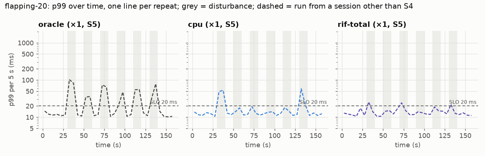

### flapping-60: antagonist on at 30.0 s, antagonist off at 60.0 s, antagonist on at 90.0 s …

| config | session | rep | p99 before | recovery | late p99 | windows over SLO | churn errors | long-lived broken | backend RSTs | bucket moves (swaps) |
|---|---|---|---|---|---|---|---|---|---|---|
| oracle | S5 | 1 | 10.6 | 30.0 s | 19.4 | 50% | 0 | 0 | 0 | 0 (0) |
| cpu | S5 | 1 | 10.7 | 10.0 s | 12.0 | 8% | 0 | 0 | 0 | 1457 (1457) |
| rif-total | S5 | 1 | 10.9 | 5.0 s | 14.2 | 12% | 0 | 0 | 0 | 2099 (2099) |

Per config, over its runs (range; median in brackets):

| config | runs | recovery (s) | windows over SLO | late p99 (ms) | long-lived broken | backend RSTs |
|---|---|---|---|---|---|---|
| oracle | 1 | 30–30 (30) | 50%–50% (50%) | 19.4–19.4 (19.4) | 0 | 0 |
| cpu | 1 | 10–10 (10) | 8%–8% (8%) | 12.0–12.0 (12.0) | 0 | 0 |
| rif-total | 1 | 5–5 (5) | 12%–12% (12%) | 14.2–14.2 (14.2) | 0 | 0 |

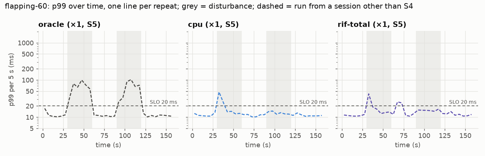

### fastflap-2: antagonist flapping, 1-s phases at 30 s, antagonist off at 150 s

| config | session | rep | p99 before | recovery | late p99 | windows over SLO | churn errors | long-lived broken | backend RSTs | bucket moves (swaps) |
|---|---|---|---|---|---|---|---|---|---|---|
| oracle | S10 | 1 | 10.3 | never | 63.0 | 100% | 0 | 0 | 0 | 0 (0) |
| cpu | S10 | 1 | 11.2 | 20 s | 15.4 | 21% | 0 | 0 | 0 | 793 (793) |
| cpu | S10 | 2 | 10.4 | 35 s | 17.0 | 21% | 0 | 0 | 0 | 527 (527) |
| rif-total | S10 | 1 | 10.5 | 30 s | 14.5 | 12% | 0 | 0 | 0 | 1873 (1873) |
| rif-total | S10 | 2 | 10.7 | 25 s | 14.4 | 21% | 0 | 0 | 0 | 1061 (1061) |

Per config, over its runs (range; median in brackets):

| config | runs | recovery (s) | windows over SLO | late p99 (ms) | long-lived broken | backend RSTs |
|---|---|---|---|---|---|---|
| oracle | 1 | never | 100%–100% (100%) | 63.0–63.0 (63.0) | 0 | 0 |
| cpu | 2 | 20–35 (27.5) | 21%–21% (21%) | 15.4–17.0 (16.2) | 0 | 0 |
| rif-total | 2 | 25–30 (27.5) | 12%–21% (17%) | 14.4–14.5 (14.4) | 0 | 0 |

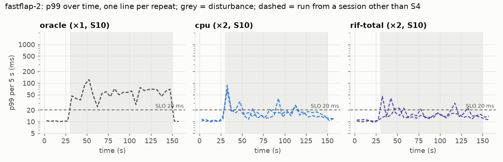

### Timescale sweep (RQ2, H3)

Share of 5-s windows with p99 over the SLO during the disturbance (antagonist on beE1 for half of each period). 2 s (S10): the neighbour switches itself every second, faster than the control period and the connection lifetime. 20 s includes S4's flapping run (10 s on/off from 60 s). 240 s = S3's antagonist run (120 s on, once): it covers only the on-phase while the others cover on and off, so it isn't comparable with them. *oracle* here is the table set for the capacities before the disturbance; no table that knows the antagonist was run on flapping. Median over runs where there are several (number of runs in brackets):

| config | 2 s | 5 s | 20 s | 60 s | 240 s (on-phase only) |
|---|---|---|---|---|---|
| oracle | 100% (1) | 96% (1) | 50% (2) | 50% (1) | 100% (1) |
| cpu | 21% (2) | 12% (1) | 15% (2) | 8% (1) | 17% (3) |
| rif | – | – | 38% (1) | – | 21% (3) |
| rif-total | 17% (2) | 12% (1) | 12% (1) | 12% (1) | 10% (2) |

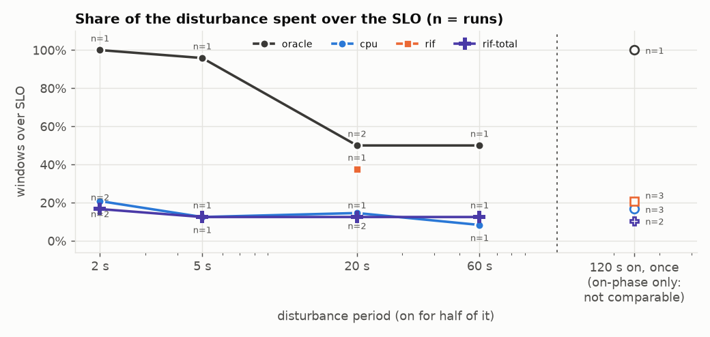

### Which signals see a neighbour on the sibling hyperthreads (H6)

beP1's signals in the static-oracle run, relative to their own mean in the 30 s before the disturbance:

| signal | before | during (mean) | ratio |
|---|---|---|---|
| cpu | 0.675 | 0.658 | **0.97×** |
| rif | 1.237 | 1.188 | **0.96×** |
| cgroup | 0.680 | 0.661 | **0.97×** |
| psi | 0.125 | 0.120 | **0.96×** |

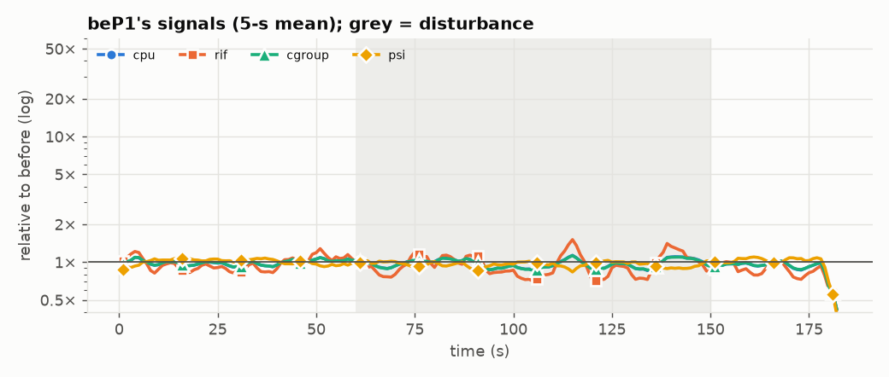

### Sibling antagonist that contends (H6)

Static oracle; antagonist on the idle hyperthreads of beP1's two cores. Mean per phase (first 5 s skipped):

| phase | p99 (median of windows) | beP1 cpu | beP1 rif | beP1 cgroup | beP1 psi |
|---|---|---|---|---|---|
| before | 10.7 | 0.627 | 1.034 | 0.634 | 0.135 |
| burn on the siblings | 10.8 | 0.652 | 1.170 | 0.654 | 0.127 |
| stream on the siblings | 11.0 | 0.692 | 1.293 | 0.690 | 0.132 |

## S4 + S10: PSI and the hook

### PSI with a kernel-queue backend (D25)

All traffic to beP2. Mean of each signal over each 40-s phase (first 5 s skipped):

| mode | phase | p99 (ms) | PSI | whole-core CPU | RIF per core | cgroup CPU |
|---|---|---|---|---|---|---|
| pool | 50% | 6 | **0.14** | 0.46 | 0.57 | 0.46 |
| pool | 90% | 14 | **0.14** | 0.81 | 2.23 | 0.80 |
| pool | 130% | 5834 | **0.05** | 1.00 | 255.85 | 0.99 |
| pool | 50% + antagonist | 12 | **0.33** | 0.84 | 1.10 | 0.46 |
| kernel | 50% | 9 | **0.28** | 0.47 | 0.62 | 0.47 |
| kernel | 90% | 27 | **0.68** | 0.82 | 2.58 | 0.82 |
| kernel | 130% | 5563 | **0.99** | 1.00 | 252.44 | 0.99 |
| kernel | 50% + antagonist | 17 | **0.45** | 0.86 | 1.00 | 0.46 |

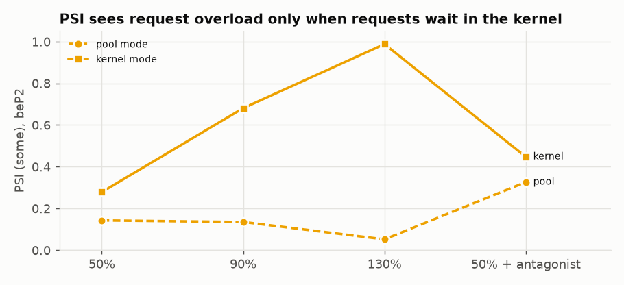

### Director at TC vs XDP (D35)

CPU time per packet on the router/LB CPU (CPU 6: router forwarding + bridge + director, so not the director alone); same program logic and output bytes for both hooks. Busy time is counted in ticks of 10 ms. S4: 1 run of 20 s per rate. S10: 4 repeats of 40 s per rate, the hooks' order alternating:

| session | repeat | hook | rate (req/s) | packets | busy ticks (10 ms each) | ns per packet | p99 (ms) |
|---|---|---|---|---|---|---|---|
| S4 | 1 | tc | 2000 | 87866 | 39 | 4439 | 8.4 |
| S4 | 1 | tc | 4000 | 176760 | 64 | 3621 | 10.0 |
| S4 | 1 | xdp | 2000 | 87866 | 45 | 5121 | 8.3 |
| S4 | 1 | xdp | 4000 | 176760 | 78 | 4413 | 9.7 |
| S10 | 1 | tc | 2000 | 176765 | 69 | 3903 | 8.2 |
| S10 | 1 | tc | 4000 | 352850 | 124 | 3514 | 9.1 |
| S10 | 1 | xdp | 2000 | 176760 | 84 | 4752 | 8.3 |
| S10 | 1 | xdp | 4000 | 352850 | 146 | 4138 | 9.3 |
| S10 | 2 | xdp | 2000 | 176760 | 84 | 4752 | 8.0 |
| S10 | 2 | xdp | 4000 | 352850 | 146 | 4138 | 9.2 |
| S10 | 2 | tc | 2000 | 176760 | 70 | 3960 | 8.2 |
| S10 | 2 | tc | 4000 | 352850 | 118 | 3344 | 9.1 |
| S10 | 3 | tc | 2000 | 176760 | 70 | 3960 | 8.2 |
| S10 | 3 | tc | 4000 | 352850 | 117 | 3316 | 9.2 |
| S10 | 3 | xdp | 2000 | 176760 | 88 | 4979 | 8.3 |
| S10 | 3 | xdp | 4000 | 352850 | 151 | 4279 | 9.2 |
| S10 | 4 | xdp | 2000 | 176760 | 88 | 4979 | 8.2 |
| S10 | 4 | xdp | 4000 | 352850 | 151 | 4279 | 9.0 |
| S10 | 4 | tc | 2000 | 176760 | 69 | 3904 | 8.2 |
| S10 | 4 | tc | 4000 | 352850 | 116 | 3288 | 9.1 |

S10, per hook and rate (ns per packet; XDP ÷ TC pairs the two hooks of one repeat):

| rate (req/s) | TC: mean (range) | XDP: mean (range) | XDP ÷ TC per repeat | mean ratio, 95% interval |
|---|---|---|---|---|
| 2000 | 3932 (3903–3960) | 4865 (4752–4979) | 1.22, 1.20, 1.26, 1.28 | 1.24 ± 0.06 |
| 4000 | 3365 (3288–3514) | 4209 (4138–4279) | 1.18, 1.24, 1.29, 1.30 | 1.25 ± 0.09 |

### Latency through the LB vs the same shares sent directly (S15)

Oracle shares, 30 s per run, pairs in alternating order. Through the LB a connection goes to one backend (bucket hashing, encapsulation, the redirector); directly, each request goes to a backend at random in proportion. So the difference is the whole LB path and the per-connection choice, not the director alone.

| load | percentile | through the LB (ms): mean (range) | direct (ms): mean (range) | LB − direct per pair: mean ± 95% |
|---|---|---|---|---|
| 50% | p50 | 1.46 (1.45–1.48) | 1.45 (1.43–1.45) | +0.02 ± 0.02 |
| 50% | p90 | 4.31 (4.27–4.39) | 4.25 (4.24–4.27) | +0.05 ± 0.05 |
| 50% | p99 | 8.46 (8.29–8.68) | 8.38 (8.28–8.44) | +0.07 ± 0.20 |
| 80% | p50 | 2.06 (2.05–2.07) | 2.03 (2.01–2.06) | +0.03 ± 0.03 |
| 80% | p90 | 5.69 (5.61–5.75) | 5.63 (5.56–5.72) | +0.06 ± 0.13 |
| 80% | p99 | 10.48 (10.24–10.69) | 10.44 (10.33–10.56) | +0.04 ± 0.28 |

