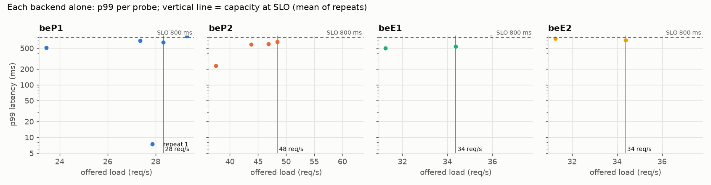
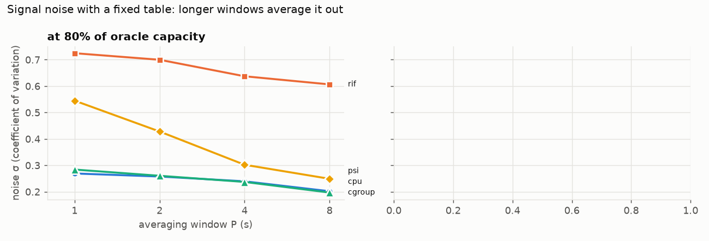
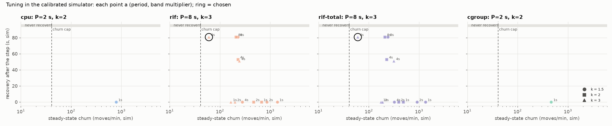
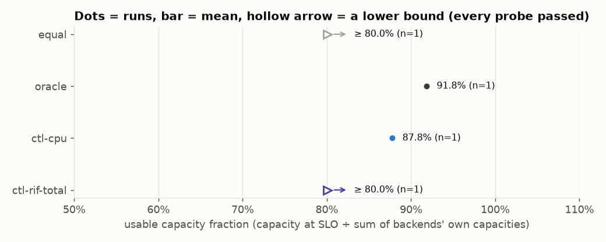
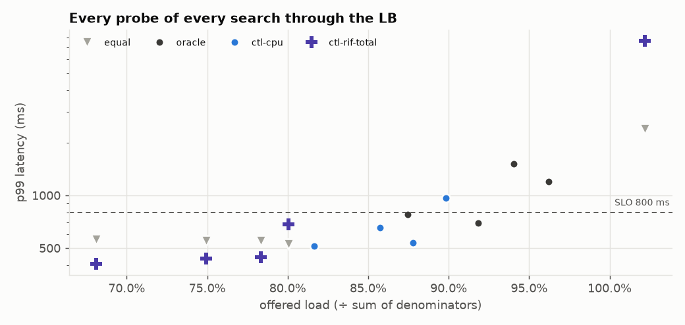
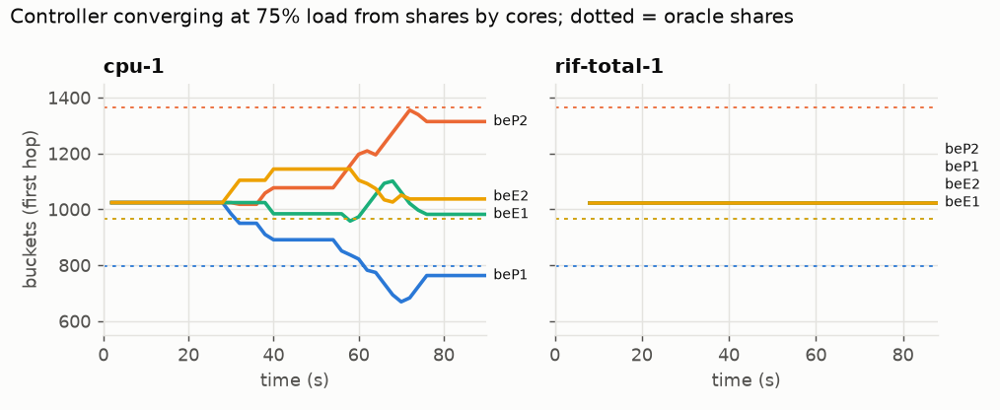
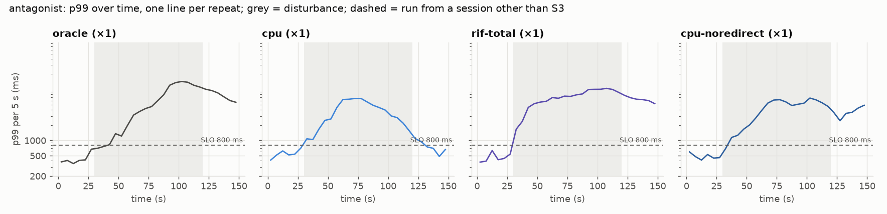
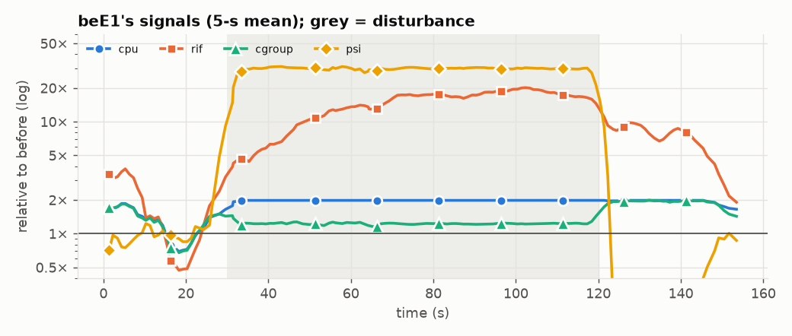

# Campaign results: cluster-20261106-085033

## S1: denominators and signal noise

Calibration: 4628688 work units per request = 40 ms on a P-core; an E-core takes 1.00× as long. beP1 slowness 1.6.

| backend | cores | theoretical (req/s) | capacity at SLO, per repeat | mean | % of theoretical | repeats differ by |
|---|---|---|---|---|---|---|
| beP1 | 2 | 31 | 28 | 28 | 91% | – |
| beP2 | 2 | 50 | 48 | 48 | 97% | – |
| beE1 | 2 | 50 | 34 | 34 | 69% | – |
| beE2 | 2 | 50 | 34 | 34 | 69% | – |

Sum of denominators: **146 req/s**. One search per backend, so this run has no capacity CV. Differences under 58.1% (2× the coarsest search resolution here) can't be resolved at all, and the real limit is higher by an amount this run can't tell.

## Tuning (D36)

Signal noise σ(P) (median over backends of the CV of P-second averages):

| signal | load | P=1 s | P=2 s | P=4 s | P=8 s |
|---|---|---|---|---|---|
| cpu | 80% | 0.269 | 0.258 | 0.239 | 0.202 |
| rif | 80% | 0.725 | 0.700 | 0.637 | 0.606 |
| cgroup | 80% | 0.284 | 0.260 | 0.237 | 0.197 |
| psi | 80% | 0.545 | 0.428 | 0.302 | 0.249 |

Chosen settings (same rule for every signal):

| signal | period | k | δ_on | δ_off | churn (moves/min, sim) | recovery after a backend loses half (sim) | note |
|---|---|---|---|---|---|---|---|
| cgroup | 2 s | 2 | 0.521 | 0.260 | 0 | 0 s |  |
| cpu | 2 s | 2 | 0.515 | 0.258 | 0 | 0 s |  |
| rif | 8 s | 3 | 1.819 | 0.910 | 60 | 81 s | no setting meets the cap of 40 moves/min; admitted up to 2 × the least churn (120) |
| rif-total | 8 s | 3 | 1.819 | 0.910 | 60 | 81 s | no setting meets the cap of 40 moves/min; admitted up to 2 × the least churn (120) |

## S2: static policies and controller-found tables (RQ1)

Usable capacity fraction = capacity at SLO through the LB ÷ sum of denominators (146 req/s).

| policy | repeats | capacity at 800 ms (req/s; ≥ = every probe passed, a lower bound) | usable fraction | range | predicted from shares | at 400 ms | at 2000 ms |
|---|---|---|---|---|---|---|---|
| equal | 1 | ≥116 | **80.0%** | 80.0%–80.0% | 77.9% | – | 99.5% |
| oracle | 1 | 134 | **91.8%** | 91.8%–91.8% | 100.0% | – | 96.2% |
| ctl-cpu | 1 | 128 | **87.8%** | 87.8%–87.8% | 93.3% | – | 89.8% |
| ctl-rif-total | 1 | ≥116 | **80.0%** | 80.0%–80.0% | 77.9% | – | 89.9% |

Resolution of these searches (highest pass to next failure): typically 15.0%, at worst 27.7%.

Generator health over all S2 probes: worst dispatch lag p99 0.000 ms, dropped 0.
Send delay p99 407 ms in one probe (oracle at 127 req/s): **it met the SLO: check that result.**
Send delay p99 675 ms in one probe (oracle at 140 req/s): it missed the SLO anyway (above capacity), so no result depends on it.
Send delay p99 329 ms in one probe (oracle at 134 req/s): **it met the SLO: check that result.**
Send delay p99 1035 ms in one probe (oracle at 137 req/s): it missed the SLO anyway (above capacity), so no result depends on it.
Send delay p99 34 ms in one probe (equal at 99 req/s): **it met the SLO: check that result.**
Send delay p99 30 ms in one probe (equal at 109 req/s): **it met the SLO: check that result.**
Send delay p99 78 ms in one probe (equal at 114 req/s): **it met the SLO: check that result.**
Send delay p99 76 ms in one probe (equal at 116 req/s): **it met the SLO: check that result.**
Send delay p99 1822 ms in one probe (equal at 149 req/s): it missed the SLO anyway (above capacity), so no result depends on it.
Send delay p99 31 ms in one probe (ctl-cpu at 119 req/s): **it met the SLO: check that result.**
Send delay p99 625 ms in one probe (ctl-cpu at 131 req/s): it missed the SLO anyway (above capacity), so no result depends on it.
Send delay p99 225 ms in one probe (ctl-cpu at 125 req/s): **it met the SLO: check that result.**
Send delay p99 187 ms in one probe (ctl-cpu at 128 req/s): **it met the SLO: check that result.**
Send delay p99 32 ms in one probe (ctl-rif-total at 99 req/s): **it met the SLO: check that result.**
Send delay p99 25 ms in one probe (ctl-rif-total at 109 req/s): **it met the SLO: check that result.**
Send delay p99 37 ms in one probe (ctl-rif-total at 114 req/s): **it met the SLO: check that result.**
Send delay p99 60 ms in one probe (ctl-rif-total at 116 req/s): **it met the SLO: check that result.**
Send delay p99 7028 ms in one probe (ctl-rif-total at 149 req/s): it missed the SLO anyway (above capacity), so no result depends on it.

## S3 + S5 + S6: step and antagonist (RQ2, RQ3, RQ4)

Per run: p99 per 5-s window of the churn traffic (75% of the summed capacities) plus long-lived connections. *Recovery*: seconds from the disturbance until p99 ≤ the SLO for 3 windows in a row. *Late p99*: median window p99 from 60 s after onset to the end of the disturbance.

### antagonist: antagonist on beE1 at 30 s, antagonist off at 120 s

| config | session | rep | p99 before | recovery | late p99 | windows over SLO | churn errors | long-lived broken | backend RSTs | bucket moves (swaps) |
|---|---|---|---|---|---|---|---|---|---|---|
| oracle | S3 | 1 | 415.3 | n/a (1.7% errors) | 12862.4 | 89% | 281 | 0 | 0 | 0 (0) |
| cpu | S3 | 1 | 537.6 | never | 2909.7 | 100% | 1 | 0 | 0 | 1223 (1223) |
| rif-total | S3 | 1 | 443.3 | n/a (1.5% errors) | 10014.8 | 100% | 249 | 0 | 1 | 511 (511) |
| cpu-noredirect | S3 | 1 | 460.0 | n/a (1.3% errors) | 5429.4 | 94% | 219 | 12 | 34 | 1409 (1409) |

### Which signals see a neighbour in another cgroup (H5)

beE1's signals in the static-oracle run, relative to their own mean in the 15 s before the disturbance:

| signal | before | during (mean) | ratio |
|---|---|---|---|
| cpu | 0.504 | 1.000 | **1.98×** |
| rif | 0.760 | 11.360 | **14.95×** |
| cgroup | 0.511 | 0.626 | **1.23×** |
| psi | 0.013 | 0.381 | **29.87×** |

