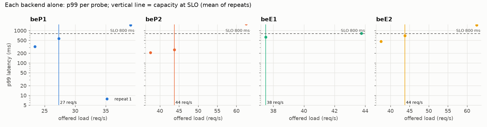
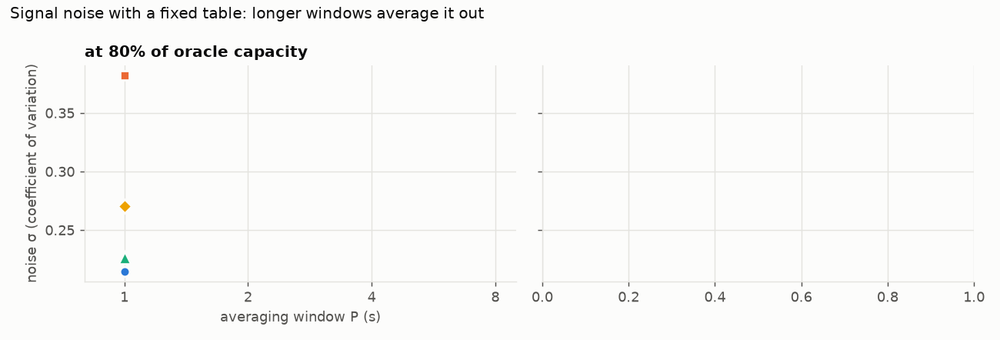
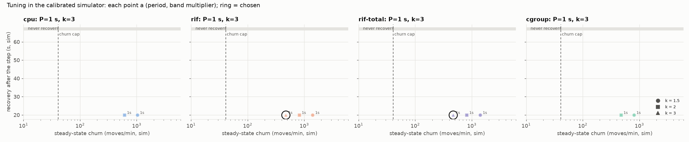
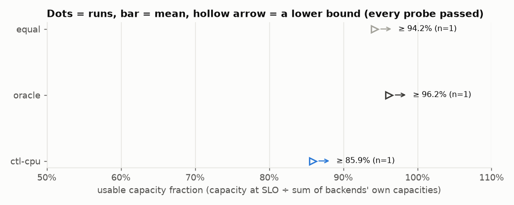
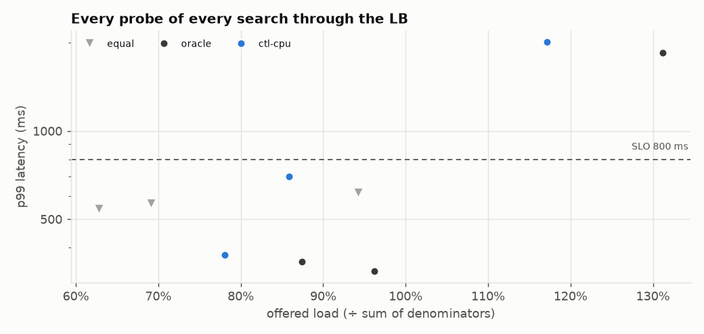
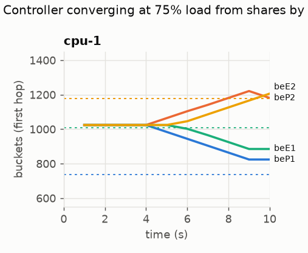
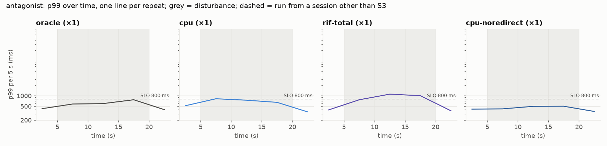
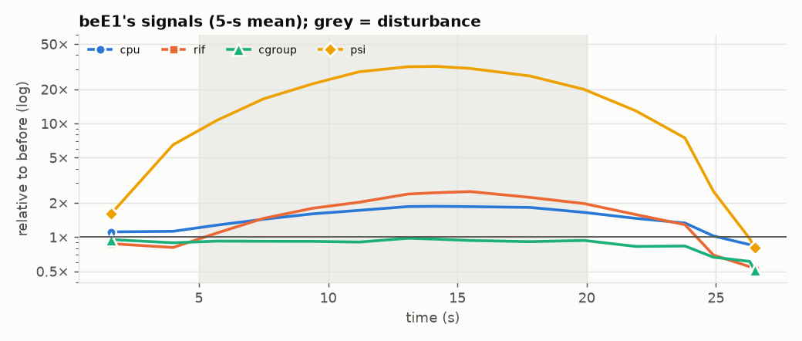

# Campaign results: cluster-dry-20261106-084421

## S1: denominators and signal noise

Calibration: 7268792 work units per request = 40 ms on a P-core; an E-core takes 1.00× as long. beP1 slowness 1.6.

| backend | cores | theoretical (req/s) | capacity at SLO, per repeat | mean | % of theoretical | repeats differ by |
|---|---|---|---|---|---|---|
| beP1 | 2 | 31 | 27 | 27 | 88% | – |
| beP2 | 2 | 50 | 44 | 44 | 88% | – |
| beE1 | 2 | 50 | 38 | 38 | 75% | – |
| beE2 | 2 | 50 | 44 | 44 | 88% | – |

Sum of denominators: **152 req/s**. One search per backend, so this run has no capacity CV. Differences under 85.7% (2× the coarsest search resolution here) can't be resolved at all, and the real limit is higher by an amount this run can't tell.

## Tuning (D36)

Signal noise σ(P) (median over backends of the CV of P-second averages):

| signal | load | P=1 s | P=2 s | P=4 s | P=8 s |
|---|---|---|---|---|---|
| cpu | 80% | 0.214 | nan | nan | nan |
| rif | 80% | 0.382 | nan | nan | nan |
| cgroup | 80% | 0.226 | nan | nan | nan |
| psi | 80% | 0.271 | nan | nan | nan |

Chosen settings (same rule for every signal):

| signal | period | k | δ_on | δ_off | churn (moves/min, sim) | recovery after a backend loses half (sim) | note |
|---|---|---|---|---|---|---|---|
| cgroup | 1 s | 3 | 0.678 | 0.339 | 0 | never |  |
| cpu | 1 s | 3 | 0.643 | 0.322 | 0 | never |  |
| rif | 1 s | 3 | 1.147 | 0.574 | 470 | 20 s | no setting meets the cap of 40 moves/min; admitted up to 2 × the least churn (939) |
| rif-total | 1 s | 3 | 1.147 | 0.574 | 470 | 20 s | no setting meets the cap of 40 moves/min; admitted up to 2 × the least churn (939) |

## S2: static policies and controller-found tables (RQ1)

Usable capacity fraction = capacity at SLO through the LB ÷ sum of denominators (152 req/s).

| policy | repeats | capacity at 800 ms (req/s; ≥ = every probe passed, a lower bound) | usable fraction | range | predicted from shares | at 400 ms | at 2000 ms |
|---|---|---|---|---|---|---|---|
| equal | 1 | ≥144 | **94.2%** | 94.2%–94.2% | 71.8% | – | 94.2% |
| oracle | 1 | ≥147 | **96.2%** | 96.2%–96.2% | 99.9% | 100.0% | 131.2% |
| ctl-cpu | 1 | ≥131 | **85.9%** | 85.9%–85.9% | 89.2% | 78.8% | 117.0% |

Resolution of these searches (highest pass to next failure): typically 36.4%, at worst 36.4%.

Generator health over all S2 probes: worst dispatch lag p99 0.001 ms, dropped 0.
Send delay p99 23 ms in one probe (oracle at 133 req/s): **it met the SLO: check that result.**
Send delay p99 37 ms in one probe (oracle at 147 req/s): **it met the SLO: check that result.**
Send delay p99 1182 ms in one probe (oracle at 200 req/s): it missed the SLO anyway (above capacity), so no result depends on it.
Send delay p99 81 ms in one probe (equal at 96 req/s): **it met the SLO: check that result.**
Send delay p99 101 ms in one probe (equal at 105 req/s): **it met the SLO: check that result.**
Send delay p99 145 ms in one probe (equal at 144 req/s): **it met the SLO: check that result.**
Send delay p99 24 ms in one probe (ctl-cpu at 119 req/s): **it met the SLO: check that result.**
Send delay p99 77 ms in one probe (ctl-cpu at 131 req/s): **it met the SLO: check that result.**
Send delay p99 1566 ms in one probe (ctl-cpu at 178 req/s): it missed the SLO anyway (above capacity), so no result depends on it.

## S3 + S5 + S6: step and antagonist (RQ2, RQ3, RQ4)

Per run: p99 per 5-s window of the churn traffic (75% of the summed capacities) plus long-lived connections. *Recovery*: seconds from the disturbance until p99 ≤ the SLO for 3 windows in a row. *Late p99*: median window p99 from 60 s after onset to the end of the disturbance.

### antagonist: antagonist on beE1 at 5 s, antagonist off at 20 s

| config | session | rep | p99 before | recovery | late p99 | windows over SLO | churn errors | long-lived broken | backend RSTs | bucket moves (swaps) |
|---|---|---|---|---|---|---|---|---|---|---|
| oracle | S3 | 1 | nan | 0 s | 597.6 | 0% | 0 | 0 | 0 | 0 (0) |
| cpu | S3 | 1 | nan | never | 747.0 | 33% | 0 | 0 | 4 | 0 (0) |
| rif-total | S3 | 1 | nan | never | 1008.2 | 67% | 0 | 0 | 1 | 516 (405) |
| cpu-noredirect | S3 | 1 | nan | 0 s | 497.4 | 0% | 0 | 0 | 0 | 0 (0) |

### Which signals see a neighbour in another cgroup (H5)

beE1's signals in the static-oracle run, relative to their own mean in the 2.5 s before the disturbance:

| signal | before | during (mean) | ratio |
|---|---|---|---|
| cpu | 0.519 | 0.964 | **1.86×** |
| rif | 0.924 | 2.350 | **2.54×** |
| cgroup | 0.616 | 0.580 | **0.94×** |
| psi | 0.011 | 0.324 | **30.58×** |

